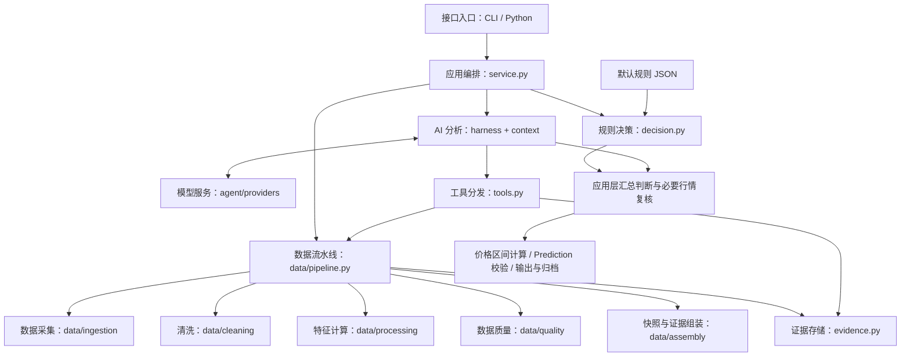

# Alpha-Pulse 模块分层与目录说明

本文按当前代码说明项目有哪些模块、每个文件负责什么，以及一次分析如何在模块间流转。适合首次接触项目的人阅读。更详细的依赖边界与扩展方式见 [开发架构指南](architecture.md)。

Alpha-Pulse 是一个 Python 市场分析与交易决策辅助程序：采集币安永续合约行情，计算指标，通过规则和可选的 AI 分析生成方向、价格区间及分析依据。当前入口是命令行和 Python 调用。

## 1. 按职责看：项目分为哪些块

代码实际有 7 个主要包：`interfaces`、`application`、`data`、`domain`、`agent`、`storage`、`config`。为了便于理解，下面按职责展开为 8 块：数据处理集中在 `data/`，规则决策和公共数据结构使用 `domain/`。

下图是**职责分层图**，每个叶子标明实际文件路径；“数据获取”“规则定义”等是职责名称，不是已经存在的子目录。这些模块由应用层组织协作，并非只能逐层向下调用。

```text
Alpha-Pulse
│
├── 1. 接口入口：用户如何使用系统
│   ├── 命令解析与结果输出        → src/interfaces/cli.py
│   ├── 实时订阅与收盘触发分析    → src/interfaces/cli.py
│   └── 源码启动入口              → src/__main__.py
│
├── 2. 应用编排：组织一次完整分析
│   ├── 组件装配与流程调度        → src/application/service.py
│   ├── 发布前复核与失败处理      → src/application/service.py
│   ├── 最终结果组装与运行归档    → src/application/service.py
│   └── 离线演示数据              → src/application/demo.py
│
├── 3. 数据层：采集、清洗、加工、质量与组装
│   ├── 数据采集与传输           → src/data/ingestion/transport.py、providers/
│   ├── 校验、标准化与去重       → src/data/cleaning/
│   ├── 技术指标、订单流与流动性 → src/data/processing/
│   ├── 时效、完整性与质量评分   → src/data/quality/
│   ├── 快照、证据与摘要组装     → src/data/assembly/
│   └── 并发采集、降级与保存编排 → src/data/pipeline.py
│
├── 4. 规则决策层：定义规则，再执行决策
│   ├── 规则定义
│   │   ├── 条件、阈值、风险参数 → src/config/default_decision_tree.json
│   │   └── 规则结构与参数校验   → src/domain/decision.py
│   └── 决策执行
│       ├── 数据资格与风险过滤   → src/domain/decision.py · evaluate()
│       ├── 做多、做空、观望判断 → src/domain/decision.py · evaluate()
│       └── 入场、止盈、止损计算 → src/domain/decision.py · zones()
│
├── 5. AI 分析层：补充证据，形成解释
│   ├── 多轮分析与输出校验        → src/agent/harness.py
│   ├── 上下文组织与历史压缩      → src/agent/context.py
│   ├── 工具定义与调用分发        → src/agent/tools.py
│   ├── 分析要求与返回格式        → src/agent/prompts.py、contracts.py
│   └── 模型服务适配              → src/agent/providers/claude.py、deepseek.py
│
├── 6. 公共数据结构：统一各模块交换的数据格式
│   └── K 线、证据、快照、分析与结果 → src/domain/models.py
│
├── 7. 证据存储：保存和查询分析依据
│   └── 证据索引、文件保存与分页 → src/storage/evidence.py
│
└── 8. 配置管理：控制系统如何运行
    ├── 环境配置读取与校验        → src/config/settings.py
    └── 配置填写模板              → .env.example
```

## 2. 按文件看：实际目录中放了什么

```text
alpha-pulse/
├── src/                         # 主程序源码
│   ├── __init__.py              # 项目包说明与版本信息
│   ├── __main__.py              # 转交 CLI 执行，可通过源码启动
│   │
│   ├── interfaces/             # 接口入口
│   │   └── cli.py              # 命令、参数、输出、持续监听和连接诊断
│   │
│   ├── application/            # 应用编排
│   │   ├── service.py          # analyze() 主流程；结果组装、复核、归档
│   │   └── demo.py             # 构造偏多、偏空、震荡三种合成行情
│   │
│   ├── data/                   # 数据处理与流水线
│   │   ├── ingestion/          # 采集层
│   │   │   ├── transport.py   # HTTP / WebSocket、代理、超时、重试和并发限制
│   │   │   └── providers/     # 数据源请求与协议适配
│   │   │       ├── binance.py # K 线分页、盘口、成交、衍生品、元数据、实时事件
│   │   │       └── external.py # GDELT、Coin Metrics、CoinGlass 和配置链上接口
│   │   ├── cleaning/           # 清洗与标准化层
│   │   │   ├── candles.py     # REST / WS K 线解析、去重、排序与缺口检测
│   │   │   ├── orderbook.py   # 盘口数字校验、排序、零数量过滤与交叉检查
│   │   │   ├── trades.py      # 成交数值和买方挂单标记校验、字段标准化
│   │   │   ├── derivatives.py # 标记价格、资金费率和持仓量校验
│   │   │   ├── external.py    # 新闻白名单、爆仓响应和链上适配器校验
│   │   │   └── numeric.py     # 有限数值及正负范围校验
│   │   ├── processing/         # 数据加工层
│   │   │   ├── indicators.py  # EMA、RSI、MACD、ATR、布林带和 VWAP
│   │   │   ├── orderflow.py   # 主动买卖金额、买入比例与样本时间范围
│   │   │   ├── liquidity.py   # 价差、中间价、可见深度与盘口不平衡度
│   │   │   └── derivatives.py # 多空爆仓金额汇总
│   │   ├── quality/            # 质量评估层
│   │   │   ├── freshness.py   # 观测时间、延迟和 K 线时效
│   │   │   ├── completeness.py # 最近窗口覆盖、必需证据和数据状态
│   │   │   └── scoring.py     # 来源可信度、时效和完整程度综合评分
│   │   ├── assembly/           # 数据组装层
│   │   │   ├── snapshot.py    # 统一 Snapshot 和问题清单
│   │   │   ├── evidence.py    # Evidence 编号、元数据、质量与载荷校验
│   │   │   ├── market.py      # K 线和衍生品证据摘要
│   │   │   └── external.py    # 新闻、链上和爆仓证据摘要
│   │   ├── pipeline.py        # MarketData / ExternalData 组织采集、处理和保存
│   │   └── errors.py          # 各数据模块共用的脱敏异常
│   │
│   ├── domain/                 # 核心业务数据结构与计算规则
│   │   ├── models.py          # 数据字段、类型、取值范围与业务一致性校验
│   │   └── decision.py        # 规则读取与校验、方向判断、价格区间计算
│   │
│   ├── agent/                  # AI 分析与工具调用
│   │   ├── harness.py         # 模型多轮执行、工具结果回传、引用与结构校验
│   │   ├── context.py         # 整理任务、行情、规则、证据索引；限制上下文大小
│   │   ├── tools.py           # 可调用工具清单、参数校验、调用预算与分发
│   │   ├── prompts.py         # 模型分析要求、证据使用要求及行为约束
│   │   ├── contracts.py       # 模型返回 JSON 格式、JSON 编码与 Agent 异常
│   │   └── providers/          # 模型服务的具体适配
│   │       ├── claude.py       # Claude 请求、流式响应和异常处理
│   │       └── deepseek.py     # DeepSeek 参数适配，复用兼容协议的调用逻辑
│   │
│   ├── storage/                # 证据持久化与检索
│   │   └── evidence.py         # 内存索引、证据 JSON 保存、摘要和原始数据分页
│   │
│   └── config/                 # 运行设置与默认规则资源
│       ├── settings.py         # 密钥、地址、代理、超时、调用预算、产物路径等
│       └── default_decision_tree.json # 默认市场过滤条件、方向条件、风险参数
│
├── tests/                      # 按模块组织的自动化测试
│   ├── interfaces/             # 命令入口与结果 Schema
│   ├── application/            # 分析流程、离线演示、异常处理与行情复核
│   ├── data/                   # 采集、清洗、特征、质量、证据、快照与实时流
│   ├── domain/                 # 规则、交易资格与模型校验
│   ├── agent/                  # 工具调用、模型适配、上下文与结果校验
│   ├── conftest.py             # 测试共用配置和样本准备
│   └── helpers.py              # 构造模拟模型响应等测试辅助对象
│
├── examples/                   # 偏多、偏空、观望的合成 JSON 示例和结果 Schema
├── scripts/
│   └── export_examples.py      # 生成示例结果与 Schema
├── docs/                       # 模块说明、开发架构文档及 README 使用的图片
├── runs/                       # 分析时生成的结果、快照、证据和调用记录
├── dist/                       # 构建产生的安装包，存在于当前工作目录
├── .env.example                # 环境变量配置示例
├── .env                        # 本地实际配置，不纳入版本管理
├── pyproject.toml              # 依赖、打包、CLI 注册和测试/检查工具配置
├── uv.lock                     # 锁定依赖版本
├── README.md                   # 项目介绍、使用说明和发展方向
└── LICENSE                     # 开源许可证
```

为方便阅读，树中省略了各包的 `__init__.py`、Git/IDE 目录和工具缓存。多数 `__init__.py` 用于标记 Python 包，`config/__init__.py` 还统一导出 `Settings`。`.venv/` 是本地 Python 环境，`.pytest_cache/` 和 `.ruff_cache/` 是工具缓存，不属于业务模块。

## 3. 容易混淆的职责边界

| 对比 | 前者负责 | 后者负责 |
| --- | --- | --- |
| 数据获取 / 数据处理 | 向外部接口请求并解析数据 | 汇总成快照、计算指标、检查完整性和时效 |
| 规则 / 决策 | 规定“满足哪些条件才允许交易” | 将当前行情代入条件，得到方向、原因和价格区间 |
| 决策 / 应用编排 | 计算某个快照对应的规则结果 | 决定何时取数、何时调用 AI、何时复核和输出 |
| 规则决策 / AI 分析 | 控制允许方向和数值计算 | 按需补充证据、解释风险，认可方向或选择观望 |
| `domain/models.py` / `agent/contracts.py` | 定义整个系统使用的数据对象及校验 | 定义发给模型的返回格式要求和 Agent 通用异常 |
| `data/ingestion/providers/` / `agent/providers/` | 对接币安等数据服务 | 对接 Claude、DeepSeek 等模型服务 |
| 证据存储 / 运行归档 | `storage/evidence.py` 保存、索引和查询证据 | `application/service.py` 保存结果、快照和运行配置；Harness 写模型调用轨迹 |

数据层由 `pipeline.py` 串起采集、清洗、加工和组装；盘口、订单流计算及外部证据封装已有独立模块。K 线分页在采集器内调用清洗函数，以规范时间、去重和推进游标。共享模型仍负责字段一致性，交易规则仍负责最终交易资格；数据时效、覆盖和评分集中在 `data/quality/`。证据编号及内容构造属于组装层，文件保存和分页检索属于存储层。

## 4. 模块之间如何协作



图中是主要调用与结果流向；公共数据结构和运行配置服务于多个模块，为保持图清晰未逐条连线。

一次正常的模型分析按以下顺序执行：

1. **接收请求**：CLI 收到币种、周期与分析模式，或 `watch` 收到 K 线收盘事件；Python 也可以直接调用 `analyze()`。
2. **采集和处理**：应用层让数据模块获取行情，计算指标，检查必要数据，生成 `Snapshot`，并保存 `Evidence`。
3. **执行规则**：`DecisionTree.evaluate()` 读取配置，检查数据资格、市场风险与方向条件，产生 `Decision` 和检查路径；必要数据不合格时提前输出观望。
4. **AI 分析**：Harness 把快照、规则结果和证据索引交给模型；模型按需调用工具，最终提交 `Assessment`。规则模式跳过这一步。
5. **发布前检查**：应用层检查 AI 与规则方向是否一致、评分是否达标。模型模式下，合格结果还要刷新行情、复核方向和价格偏移；不合格则输出观望。
6. **生成与保存**：合格时由 `zones()` 计算价格区间，`Prediction` 校验最终结构，应用层保存结果与实际执行阶段的产物。

关键业务对象可以这样理解：

| 对象 | 含义 | 定义位置 |
| --- | --- | --- |
| `Candle` | 一根 K 线 | `domain/models.py` |
| `Evidence` | 一条带来源、时间、状态和原始数据的证据 | `domain/models.py` |
| `Snapshot` | 一次分析使用的行情汇总 | `domain/models.py` |
| `Decision` | 规则给出的方向、原因和检查路径 | `domain/decision.py` |
| `Assessment` | AI 或规则模式形成的判断、评分、理由和引用 | `domain/models.py` |
| `Prediction` | 最终交付用户的结构化结果 | `domain/models.py` |

## 5. 新人从哪里开始阅读

建议顺序为：`interfaces/cli.py` → `application/service.py` → `data/pipeline.py` → `domain/models.py` → `domain/decision.py` 与默认规则 JSON → `agent/harness.py`。先理解一次分析如何完成，再按需深入具体数据源、指标、模型适配和证据存储。

当前是模块化单体程序，没有 Web API、前端、自动下单、数据库、共享行情缓存、多 Agent 或回测模块。`runs/` 保存分析记录，但尚未形成分析到期后的自动效果评估流程。
